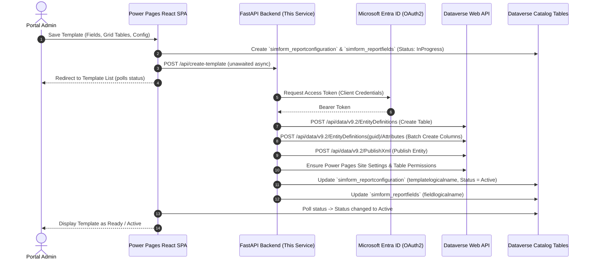

# Circular Action Alliance - Dataverse Backend API

A high-performance FastAPI service designed to bridge the frontend Form/Template Builder (Power Pages SPA / React) with Microsoft Dataverse. It automates the dynamic provisioning and modification of Dataverse tables, columns, relationships, Power Pages Web API site settings, and table permissions in real time.

---

## Table of Contents

- [Overview](#overview)
- [Repository File Structure](#repository-file-structure)
- [Architecture & Workflow](#architecture--workflow)
- [Supported Field Types](#supported-field-types)
- [Prerequisites](#prerequisites)
- [Environment Configuration](#environment-configuration)
- [How to Run](#how-to-run)
  - [Option 1: Local Python Environment](#option-1-local-python-environment-recommended-for-development)
  - [Option 2: Docker Container](#option-2-docker-container)
  - [Option 3: Docker Compose (Hot-Reload)](#option-3-docker-compose-hot-reload)
- [API Endpoints Reference](#api-endpoints-reference)
  - [Health & Diagnostics](#health--diagnostics)
  - [Table & Field Introspection](#table--field-introspection)
  - [Creation & Updates](#creation--updates)
  - [Power Pages Security & Web API Provisioning](#power-pages-security--web-api-provisioning)
- [Power Pages & Catalog Architecture](#power-pages--catalog-architecture)
- [Deployment Guide (Render.com)](#deployment-guide-rendercom)
- [Troubleshooting & Gotchas](#troubleshooting--gotchas)

---

## Overview

The Circular Action Alliance application enables administrators to dynamically build custom form templates directly in the frontend portal. When an admin creates or modifies a template, this backend API interacts with the Microsoft Dataverse Web API to:

1. **Provision Entities & Attributes**: Dynamically creates Dataverse tables and attributes (Text, Numbers, Decimals, Dates, Choices, Booleans, Files, Images, and Lookups).
2. **Synchronize Catalog Tables**: Automatically populates configuration tracking records in Dataverse (`simform_reportconfigurations` and `simform_reportfieldses`) and manages lifecycle state flags (`simform_displaystatus`).
3. **Configure Power Pages Security**: Creates and updates Power Pages Site Settings (`Webapi/<table_name>/enabled`, `Webapi/<table_name>/fields`, `Webapi/<table_name>/error-detail`) and Table Permissions (`mspp_entitypermission` / `powerpagecomponent`) with appropriate CRUD/Append rights linked to Web Roles (`Administrators`, `Authenticated Users`).
4. **Wire Grid & Parent Lookups**: Provisions relationship definitions and lookup fields needed for child grid tables and activity report bindings.

---

## Repository File Structure

Below is an overview of every file in the repository and its role:

| File / Folder | Purpose & Description |
|---|---|
| `main.py` | **Application Entry Point & HTTP API Router**. Implements the FastAPI web application, HTTP routes, request/response Pydantic models, CORS middleware, and Chrome Private Network Access (PNA) header injection. Acts as the interface between the client and the underlying Dataverse operations. |
| `dataverse.py` | **Core Dataverse Engine & Business Logic**. Contains all low-level communication logic with Microsoft Dataverse via Entra ID (OAuth2 Client Credentials) and OData REST requests. Handles entity/attribute metadata payloads, schema naming, table publication, Power Pages Web API site settings, table permission synchronization, relationship creation, and choice option management. |
| `requirements.txt` | **Python Dependencies**. Declares the exact runtime packages needed (`fastapi`, `uvicorn`, `httpx`, `python-dotenv`). |
| `Dockerfile` | **Production Container Specification**. Builds a minimal `python:3.13-slim` container image that configures the working directory, installs dependencies, copies code, and exposes port `8942`. Compatible with both local Docker runs and containerized cloud deployment (e.g. Render). |
| `docker-compose.yml` | **Local Multi-Container Orchestration**. Enables one-command containerized local development with volume bind-mounts for live code reloading without image rebuilding. |
| `render.yaml` | **Render.com Infrastructure Blueprint**. Declares the infrastructure-as-code specification for deploying the API as a Python Web Service on Render, including build/start commands and required environment variable hooks. |
| `.env.example` | **Environment Template**. Reference file detailing all required and optional environment variables, complete with descriptions and fallback defaults. |
| `.env` | **Active Local Configuration** *(Local only, git-ignored)*. Stores live Azure AD app registration secrets and Dataverse target endpoints. |
| `.gitignore` | **Git Exclusion Rules**. Excludes Python bytecode caches (`__pycache__`), virtual environment folders (`.venv`), and local secret files (`.env`). |
| `.dockerignore` | **Docker Build Exclusions**. Excludes `.git`, `.venv`, and temporary files from the Docker build context for fast, lean builds. |
| `README.md` | **Documentation**. Full developer setup, architectural reference, endpoint specifications, and operations manual. |

---

## Architecture & Workflow



---

## Supported Field Types

The builder maps frontend UI palette types directly to Microsoft Dataverse attribute metadata:

| Frontend / UI Field Type | `fieldType` Value | Dataverse Attribute Metadata | Description & Configuration Options |
|---|---|---|---|
| **Text** | `Text` | `StringAttributeMetadata` | Single line text. Supported options: `maxLength` (default: 100). |
| **Multiline Text** | `Memo` | `MemoAttributeMetadata` | Multiline text area. Supported options: `maxLength` (default: 2000). |
| **Whole Number** | `Integer` | `IntegerAttributeMetadata` | 32-bit integer. Supported options: `minValue` (default: -2147483648), `maxValue` (default: 2147483647). |
| **Decimal** | `Decimal` | `DecimalAttributeMetadata` | Floating point decimal. Supported options: `precision` (default: 2), `minValue`, `maxValue`. |
| **Currency** | `Currency` | `MoneyAttributeMetadata` | Currency field. Supported options: `precision` (default: 2), `minValue` (default: 0), `maxValue`. |
| **Date** | `DateTime` | `DateTimeAttributeMetadata` | Date only. Option: `dateFormat: "DateOnly"`. |
| **Date & Time** | `DateTime` | `DateTimeAttributeMetadata` | Date and time. Option: `dateFormat: "DateAndTime"`. |
| **Choice (Dropdown)** | `Choice` | `PicklistAttributeMetadata` | Single select picklist. Options: `options: [{label, value}]`, `defaultOptionValue`. |
| **Multi-Select Choice** | `Choice` | `MultiSelectPicklistAttributeMetadata` | Multi-select picklist. Enabled by setting `allowMultiple: true`. |
| **Yes / No (Boolean)** | `Boolean` | `BooleanAttributeMetadata` | Two-option boolean. Supported options: `defaultValue`, `trueLabel` (default: "Yes"), `falseLabel` (default: "No"). |
| **File** | `File` | `FileAttributeMetadata` | File attachment. Supported options: `maxSizeKb` (default: 32768 KB / 32MB). |
| **Image** | `Image` | `ImageAttributeMetadata` | Image upload. Supported options: `maxSizeKb` (default: 10240 KB / 10MB). |
| **Lookup** | `Lookup` | N:1 Relationship | Creates a Dataverse relationship between the entity and a target table (`lookupTargetEntity`), plus auto-configures Web API read access. |

---

## Prerequisites

1. **Python 3.11+** (Python 3.13 recommended).
2. **Microsoft Entra ID (Azure AD) App Registration**:
   - Client ID & Client Secret.
   - Tenant ID.
   - Configured as an **Application User** in the Dataverse Power Platform Admin Center with the **System Administrator** role (or custom role with entity/attribute metadata modification rights).
3. **Dataverse Environment URL** (e.g. `https://yourorg.api.crm8.dynamics.com`).
4. **Docker / Docker Compose** (Optional, if running via containers).

---

## Environment Configuration

Create a `.env` file in the root directory by copying `.env.example`:

```bash
# Windows
copy .env.example .env

# Linux / macOS
cp .env.example .env
```

### Environment Variables Reference

| Variable | Required | Default Value | Description |
|---|---|---|---|
| `DATAVERSE_ENV_URL` | **Yes** | — | Base URL of your Dataverse environment (e.g. `https://yourorg.api.crm8.dynamics.com`). |
| `DATAVERSE_TENANT_ID` | **Yes** | — | Microsoft Entra ID Tenant GUID. |
| `DATAVERSE_CLIENT_ID` | **Yes** | — | Azure App Registration Application (Client) ID. |
| `DATAVERSE_CLIENT_SECRET` | **Yes** | — | Azure App Registration Client Secret value. |
| `ALLOWED_ORIGINS` | No | `*` | Comma-separated list of allowed browser origins for CORS (e.g. `http://localhost:5183,https://yourportal.powerappsportals.com`). |
| `DEFAULT_TABLE_PREFIX` | No | `new` | Schema prefix applied to tables and columns when not explicitly provided (e.g. `new_tablename`). |
| `SOLUTION_UNIQUE_NAME` | No | `""` (Default Solution) | Unique name of an unmanaged solution where new tables/attributes will be bundled. |
| `DEFAULT_OWNERSHIP_TYPE` | No | `UserOwned` | Table ownership: `UserOwned` or `OrganizationOwned`. |
| `POWER_PAGES_WEBSITE_ID` | No | Project Default | The `mspp_website` GUID for which Web API site settings and table permissions are created. |
| `ADMINISTRATORS_WEBROLE_ID` | No | Project Default | The `mspp_webrole` GUID for the "Administrators" role bound to table permissions. |

---

## How to Run

### Option 1: Local Python Environment (Recommended for Development)

1. **Create and activate a virtual environment**:

   **Windows (PowerShell/CMD)**:
   ```bash
   python -m venv .venv
   .venv\Scripts\activate
   ```

   **macOS / Linux**:
   ```bash
   python3 -m venv .venv
   source .venv/bin/activate
   ```

2. **Install dependencies**:
   ```bash
   pip install -r requirements.txt
   ```

3. **Run the FastAPI server**:
   ```bash
   uvicorn main:app --reload --port 8942
   ```

4. **Access the API**:
   - Interactive Swagger API Documentation: [http://localhost:8942/docs](http://localhost:8942/docs)
   - Alternative ReDoc Documentation: [http://localhost:8942/redoc](http://localhost:8942/redoc)
   - Health check: [http://localhost:8942/api/health](http://localhost:8942/api/health)

---

### Option 2: Docker Container

Build and run using the provided `Dockerfile`:

```bash
# 1. Build the Docker image
docker build -t dataverse-backend .

# 2. Run the container with .env file mounted
docker run -d --name dataverse-backend -p 8942:8942 --env-file .env dataverse-backend
```

Stop and remove the container:
```bash
docker stop dataverse-backend && docker rm dataverse-backend
```

---

### Option 3: Docker Compose (Hot-Reload)

The included `docker-compose.yml` mounts your local Python source files directly into the container and enables `--reload`. Any changes made to `main.py` or `dataverse.py` are immediately reflected without rebuilding the image:

```bash
# Start container in background
docker compose up -d

# View logs
docker compose logs -f

# Stop container
docker compose down
```

---

## API Endpoints Reference

### Health & Diagnostics

#### `GET /api/health`
Lightweight health probe for container orchestrators and Render monitoring.
- **Response**: `{"ok": true}`

#### `GET /api/config`
Verifies whether the backend has successfully loaded Dataverse environment credentials (does not leak secrets).
- **Response**:
  ```json
  {
    "configured": true,
    "envUrl": "https://yourorg.api.crm8.dynamics.com"
  }
  ```

---

### Table & Field Introspection

#### `GET /api/lookup?name={logical_name}`
Checks if a table exists in the environment by its logical name.
- **Parameters**: `name` (string, e.g. `account`, `new_customtable`)
- **Response**:
  ```json
  {
    "found": true,
    "logicalName": "new_customtable",
    "displayName": "Custom Table",
    "metadataId": "12345678-abcd-ef01-2345-6789abcdef01"
  }
  ```

#### `GET /api/tables`
Returns a list of all tables in the environment. Used by the Lookup field picker in the frontend.
- **Response**:
  ```json
  {
    "tables": [
      {
        "logicalName": "account",
        "displayName": "Account",
        "schema": "Account",
        "collection": "accounts",
        "isCustom": false
      }
    ]
  }
  ```

#### `GET /api/tables/{logical_name}/fields`
Returns lightweight column information for a specific table. Used to pick display fields for Lookups.
- **Response**:
  ```json
  {
    "fields": [
      {
        "logicalName": "name",
        "displayName": "Account Name",
        "type": "String",
        "isPrimary": true
      }
    ]
  }
  ```

#### `GET /api/tables/{logical_name}/fields/{field_logical_name}/detail`
Retrieves detailed, type-specific configuration for an existing attribute (min/max range, precision, choice options with numeric values, boolean labels). Used when populating the Edit Field modal.
- **Response**:
  ```json
  {
    "logicalName": "new_status",
    "displayName": "Status",
    "description": "Approval Status",
    "type": "Choice",
    "required": true,
    "allowMultiple": false,
    "options": [
      {"label": "Pending", "value": 100000000},
      {"label": "Approved", "value": 100000001}
    ]
  }
  ```

---

### Creation & Updates

#### `POST /api/create`
Creates a standalone table and an optional initial field, then publishes customizations.

**Request Payload (`CreateTablePayload`)**:
```json
{
  "tableDisplayName": "Material Pickup Request",
  "tableDescription": "Tracks material pickups from collection centers",
  "primaryDisplayName": "Request Number",
  "publish": true,
  "addField": true,
  "fieldDisplayName": "Quantity (kg)",
  "fieldType": "Decimal",
  "fieldOptions": {
    "precision": 2,
    "minValue": 0.0,
    "maxValue": 50000.0
  }
}
```

#### `POST /api/create-template`
Creates a full table and multiple fields for an administrator-defined template, configures Power Pages Web API access, and writes logical names back to Dataverse catalog tables (`simform_reportconfigurations` and `simform_reportfieldses`).

**Request Payload (`CreateTemplatePayload`)**:
```json
{
  "configurationId": "3fa85f64-5717-4562-b3fc-2c963f66afa6",
  "tableDisplayName": "E-Waste Compliance Report",
  "primaryDisplayName": "Report Identifier",
  "fields": [
    {
      "fieldRecordId": "9b1deb4d-3b7d-4bad-9bdd-2b0d7b3dcb6d",
      "displayName": "Collection Date",
      "type": "DateTime",
      "dateFormat": "DateOnly",
      "required": true
    },
    {
      "fieldRecordId": "8c2deb4d-3b7d-4bad-9bdd-2b0d7b3dcb6e",
      "displayName": "Total Weight (MT)",
      "type": "Decimal",
      "precision": 3,
      "minValue": 0
    },
    {
      "fieldRecordId": "7a3deb4d-3b7d-4bad-9bdd-2b0d7b3dcb6f",
      "displayName": "Material Category",
      "type": "Choice",
      "options": [
        {"label": "Batteries", "value": "100000000"},
        {"label": "Electronics", "value": "100000001"}
      ]
    }
  ]
}
```

#### `POST /api/update-template`
Updates an existing template's table by adding newly appended columns and modifying attributes of existing columns (labels, descriptions, ranges, choice options).

**Request Payload (`UpdateTemplatePayload`)**:
```json
{
  "configurationId": "3fa85f64-5717-4562-b3fc-2c963f66afa6",
  "tableLogicalName": "new_ewastecompliancereport",
  "fields": [
    {
      "isNew": true,
      "fieldRecordId": "11111111-2222-3333-4444-555555555555",
      "displayName": "Facility Notes",
      "type": "Memo"
    },
    {
      "isNew": false,
      "logicalName": "new_totalweightmt",
      "fieldRecordId": "8c2deb4d-3b7d-4bad-9bdd-2b0d7b3dcb6e",
      "displayName": "Total Net Weight (MT)",
      "type": "Decimal",
      "precision": 3,
      "maxValue": 99999
    }
  ]
}
```

---

### Power Pages Security & Web API Provisioning

#### `POST /api/ensure-webapi-access`
Configures Power Pages Site Settings and Table Permissions for a table, granting programmatic Web API access to the portal frontend.

**Request Payload (`EnsureWebApiAccessPayload`)**:
```json
{
  "entityLogicalName": "new_ewastecompliancereport",
  "entityDisplayName": "E-Waste Compliance Report",
  "fields": ["new_name", "new_collectiondate", "new_totalweightmt"],
  "create": true,
  "read": true,
  "write": true,
  "append": true,
  "appendto": true,
  "bindAuthenticatedUsers": true
}
```

#### `POST /api/ensure-grid-table-lookup`
Provisions an N:1 Lookup column between a child grid table and a parent template table so child row submissions can be bound via the Power Pages Web API.
- **Request Payload**:
  ```json
  {
    "gridTableLogicalName": "new_materialloaddetail",
    "templateTableLogicalName": "new_ewastecompliancereport"
  }
  ```
- **Response**:
  ```json
  {
    "lookupSchemaName": "new_ewastecompliancereport_new_materialloaddetail"
  }
  ```

---

## Power Pages & Catalog Architecture

### 1. Catalog Synchronization
The backend integrates with two custom Dataverse tables representing the template catalog:
- `simform_reportconfigurations`: Stores master template records. The backend writes:
  - `simform_templatelogicalname`: Populated with the generated schema name (e.g. `new_monthlyhaulreport`).
  - `simform_displaystatus`: Set to `Active` (or `Error` on fatal creation failure).
- `simform_reportfieldses`: Stores field definitions. The backend writes:
  - `simform_fieldlogicalname`: The exact Dataverse attribute name created (e.g. `new_contractorname`).

### 2. Power Pages Site Settings & Table Permissions
To allow the frontend SPA running on Power Pages to interact with newly provisioned Dataverse tables via the Power Pages Web API (`/_api/...`), `ensure_webapi_access` automatically configures:
1. **Site Settings**:
   - `Webapi/<table_name>/enabled`: Set to `true`.
   - `Webapi/<table_name>/fields`: Set to `*` or a comma-separated list of enabled columns.
   - `Webapi/<table_name>/error-detail`: Set to `true`.
2. **Table Permissions (`mspp_entitypermission`)**:
   - Creates a **Global** scoped permission with Read, Create, Write, Append, and AppendTo rights.
   - Associates the permission with the **Administrators** web role and optionally **Authenticated Users**.

### 3. Chrome Private Network Access (PNA)
When developing locally with the Power Pages portal hosted on public HTTPS (`https://yourportal.powerappsportals.com`) calling the local backend at `http://localhost:8942`, modern Chromium browsers enforce the **Private Network Access** specification.

This service includes custom middleware in `main.py` that injects the `Access-Control-Allow-Private-Network: true` header on both actual requests and preflight `OPTIONS` calls, preventing preflight blocks.

---

## Deployment Guide (Render.com)

This application is ready to deploy on **Render** as a Python Web Service.

### Using `render.yaml` Blueprint (Automated)
1. Push this repository to GitHub.
2. Log in to [Render](https://render.com) and go to **Blueprints**.
3. Connect your GitHub repository. Render will automatically read `render.yaml`.
4. In the dashboard, fill in the secret environment variables:
   - `DATAVERSE_ENV_URL`
   - `DATAVERSE_TENANT_ID`
   - `DATAVERSE_CLIENT_ID`
   - `DATAVERSE_CLIENT_SECRET`
   - `ALLOWED_ORIGINS`
5. Click **Apply**.

### Manual Web Service Creation
1. Go to **Render Dashboard** -> **New** -> **Web Service**.
2. Connect your repo and set:
   - **Environment**: `Python`
   - **Build Command**: `pip install -r requirements.txt`
   - **Start Command**: `uvicorn main:app --host 0.0.0.0 --port $PORT`
   - **Health Check Path**: `/api/health`
3. Under **Environment Variables**, add the variables detailed above.
4. Click **Create Web Service**.

> [!NOTE]
> On Render's Free tier, the service automatically sleeps after 15 minutes of inactivity. The first request after sleep takes 30-50 seconds to wake up. For production environments, use a paid tier (Starter or Standard) to prevent idle timeouts.

---

## Troubleshooting & Gotchas

### 1. Dataverse Metadata Timeouts
Publishing Dataverse customizations (`PublishXml` / `PublishAllXml`) can take anywhere from 15 to 90 seconds depending on environment load. The timeouts in `dataverse.py` are set accordingly:
- Standard Requests: `120s`
- Publish Operations: `180s`
- Token Acquisition: `20s`

Do not reduce these values or long metadata operations will fail prematurely.

### 2. Association Permissions Error (`Append` / `AppendTo`)
If submitting a form yields an error such as:
`"You don't have permission to associate or disassociate table X to Y"`
This occurs because writing a lookup relationship requires:
- `Append` permission on the referencing row being created.
- `AppendTo` permission on the referenced parent row.

Call `/api/ensure-webapi-access` with `"append": true` and `"appendto": true` on both entities to ensure these permissions are active.

### 3. Missing Solution Warning
If `SOLUTION_UNIQUE_NAME` is left blank, tables and columns are added directly to the environment's **Default Solution**. For clean ALM (Application Lifecycle Management) and exportable solutions, create an unmanaged solution in Dataverse (e.g. `CircularActionAlliance`) and set `SOLUTION_UNIQUE_NAME=CircularActionAlliance` in `.env`.